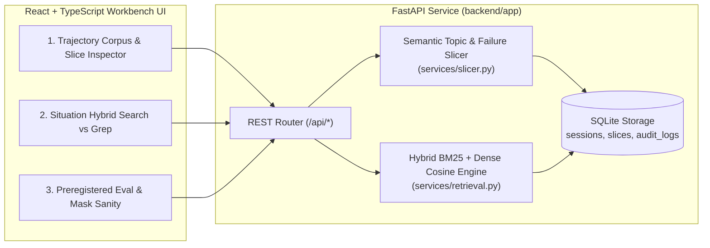

# Sentinel Workbench (`sentinel-workbench-alan-vo`) — Alan Vo | AI & Machine Learning

> Work in progress. This checkpoint may be incomplete or fail tests. See PLAN.md and STATUS.md before use.


Sentinel Workbench is an AI/ML developer workbench for **agent session memory indexing, semantic topic slicing, situation-based hybrid retrieval, and preregistered retrieval evaluation**. Coding and operations agents frequently waste context window tokens by running raw `grep` and `sed` scans across long multi-session transcripts, or lose critical failure-recovery context when transcripts are split by arbitrary fixed token windows. Designed for AI engineers and agent infrastructure researchers, Sentinel Workbench segments multi-session agent trajectories by lexical topic drift and failure-recovery episodes, indexes them for hybrid sparse (BM25) + dense (n-gram cosine) retrieval, and verifies retrieval quality against preregistered evaluation gates and candidate-mask sanity checks.

---

## Architecture



---

## Implemented Capabilities (Round 1 Checkpoint: `session-memory-topic-slicing-search`)

1. **Multi-Session Trajectory Ingestion & Semantic Topic Slicing**:
   - Stores verbatim agent turns, timestamps, executed commands/tools, and structured failure indicators in SQLite (`backend/app/core/database.py`).
   - Segments trajectories using **Semantic Topic & Failure-Boundary Slicing** (`build_semantic_topic_slices` in `backend/app/services/slicer.py`), keeping failure turns coupled with their immediate diagnostic/remediation turn rather than severing them at arbitrary token counts.
   - Computes a parallel **Fixed-Token-Window Baseline** (`build_fixed_window_slices`) on every session for direct comparative inspection.
2. **Situation-Based Hybrid Retrieval & Token Efficiency Estimator**:
   - Ranks slices using combined **BM25 sparse lexical scoring**, **character/word n-gram cosine similarity**, and **failure-episode retention weighting** (`rank_slices` in `backend/app/services/retrieval.py`).
   - Quantifies context window token reduction compared against both full-corpus injection and naive `grep` line scans.
3. **Reproducible Retrieval Evaluation & Candidate-Mask Sanity Check**:
   - Evaluates paired situation queries across the multi-session debugging scar corpus, reporting **Recall@1**, **Mean Reciprocal Rank (MRR)**, **Wilson 95% confidence intervals**, and **candidate-pool self-exclusion (`fill_diagonal`) bug detection**.

### Planned Incremental Milestones (See `PLAN.md` & `feature-plan.json`)

- `preregistered-retrieval-eval-gates`: Frozen threshold gates, majority-class baseline comparison, paired McNemar checkpoint significance testing, and separate self-report vs recompute artifacts.
- `ingest-admission-governor-simulator`: Per-shard memory admission watermark simulator, server target-concurrency pushback headers, decorrelated client backoff, and drain-free thread spawn headroom checks.
- `decision-flywheel-writeback-audit`: Tiered BM25 decision cache write-back analyzer and pre-finalize exists-lane latency probe.
- `oidc-keycloak-auth-and-llm-advisory`: OIDC authorization-code + PKCE login with Keycloak/SAML brokering and opt-in multi-provider server-side LLM advisory synthesis.

---

## AI/ML Evaluation

Sentinel Workbench includes a deterministic, offline-reproducible retrieval benchmark over 4 multi-session operational debugging trajectories (21 turns total, 6 paired situation queries where each query describes an active failure situation that requires retrieving both the failure turn and its remediation context).

### Reproducible Evaluation Command

```bash
PYTHONPATH=backend .venv/bin/python -c "
from app.core.database import init_db, load_all_slices_by_strategy, load_session_title_map
from app.services.retrieval import run_benchmark_evaluation
import json

init_db('/tmp/sentinel_eval_repro.db')
sem = load_all_slices_by_strategy('semantic_topic', '/tmp/sentinel_eval_repro.db')
fix = load_all_slices_by_strategy('fixed_window', '/tmp/sentinel_eval_repro.db')
titles = load_session_title_map('/tmp/sentinel_eval_repro.db')
report = run_benchmark_evaluation(sem, fix, titles, scoring_mode='hybrid')
print(json.dumps(report.model_dump(), indent=2))
"
```

### Measured Results (`n = 6` paired failure-recovery situation queries)

| Slicing Strategy | Scoring Mode | Recall@1 | 95% Wilson CI | MRR | Mean Token Reduction vs Naive Grep | Candidate Mask Integrity |
| --- | --- | --- | --- | --- | --- | --- |
| **Semantic Topic + Failure Boundary** | `hybrid` | **1.0000** (6/6) | `[0.6097, 1.0000]` | **1.0000** | **6.14x** | `PASS` (0.0 simulated `fill_diagonal` recall) |
| **Fixed-Token Window (45 tokens)** | `hybrid` | **0.5000** (3/6) | `[0.1876, 0.8124]` | **0.5000** | **6.14x** | `PASS` |

### Failure Cases & Limitations

- **Fixed-Window Boundary Severing**: When fixed-window chunking hits its token budget mid-episode, it separates the failure turn (e.g., `Turn 2` error output) from the remediation turn (`Turn 3` fix command), causing fixed-window slices to fail the paired failure+remediation grounding criterion on 3 of the 6 benchmark queries.
- **Small Sample Confidence Intervals**: Because the built-in seed benchmark contains `n = 6` queries, the 95% Wilson confidence interval for Recall@1 spans `[0.6097, 1.0000]`. Headline percentages on small evaluation sets should always be interpreted alongside their confidence interval bounds.
- **Lexical Drift Sensitivity**: Purely lexical/n-gram boundary detection can over-split when an agent switches between two tools with completely disjoint command vocabularies during a single logical task unless the failure-recovery coupling rule holds them together.

---

## Quickstart: Install, Run, and Test

### 1. Backend Setup & Tests

```bash
python3 -m venv .venv
.venv/bin/pip install -r backend/requirements.txt
PYTHONPATH=backend .venv/bin/python -m pytest backend/tests -v
```

Run the FastAPI server locally on `127.0.0.1:8000`:

```bash
PYTHONPATH=backend .venv/bin/uvicorn app.main:app --host 127.0.0.1 --port 8000
```

### 2. Frontend Setup, Build & Tests

```bash
cd frontend
npm install
npm run build
npm test
```

Run the Vite development UI on `127.0.0.1:5173`:

```bash
cd frontend
npm run dev
```

### 3. Docker Compose (Local Binding Only)

```bash
docker compose up --build
```

Both development ports bind strictly to `127.0.0.1` (`127.0.0.1:8000` for backend API, `127.0.0.1:8080` for frontend UI).

---

## API Endpoint Reference

| Method | Path | Description |
| --- | --- | --- |
| `GET` | `/api/health` | Service health check, version metadata, and indexed corpus counts |
| `GET` | `/api/sessions` | List indexed agent trajectories with optional `repository`, `limit`, and `offset` |
| `POST` | `/api/sessions` | Ingest a multi-session trajectory and compute semantic topic + fixed-window slices |
| `GET` | `/api/sessions/{session_id}` | Retrieve full trajectory turns and generated slices for both strategies |
| `DELETE` | `/api/sessions/{session_id}` | Delete an indexed trajectory and its slices |
| `POST` | `/api/search` | Execute comparative situation search (`semantic_topic` vs `fixed_window`, `hybrid`/`bm25`/`dense`) |
| `POST` | `/api/eval/run` | Run the reproducible retrieval evaluation benchmark and mask sanity verification |
| `GET` | `/api/audit-logs` | Retrieve recent persistence and indexing audit log entries |

---

## Provider & Security Configuration Reference

 All core indexing, slicing, retrieval, and evaluation workflows run **100% deterministically offline** with zero external API calls. Planned opt-in LLM advisory and OIDC settings in `.env.example`:

| Variable | Purpose | Default |
| --- | --- | --- |
| `SENTINEL_DB_PATH` | SQLite database file location | `./data/sentinel_workbench.db` |
| `SENTINEL_ENV` | Runtime environment (`development` / `production`) | `development` |
| `OIDC_ISSUER_URL` | External Keycloak OIDC issuer URL (planned milestone) | *(blank)* |
| `LLM_PROVIDER` | Opt-in advisory provider (`openai-compatible`, `anthropic`, `gemini`, `ollama`) | `openai-compatible` |
| `LLM_MODEL` | Operator-selected model identifier | *(blank)* |
| `LLM_BASE_URL` | Operator-configured provider base URL | *(blank)* |
| `LLM_API_KEY` | Server-side credential variable (never exposed to client) | *(blank)* |

---

## Author & License

Created by **Alan Vo** (<alanvo@gmail.com>, GitHub: [ALANDVO](https://github.com/ALANDVO)). Released under the [MIT License](LICENSE).
